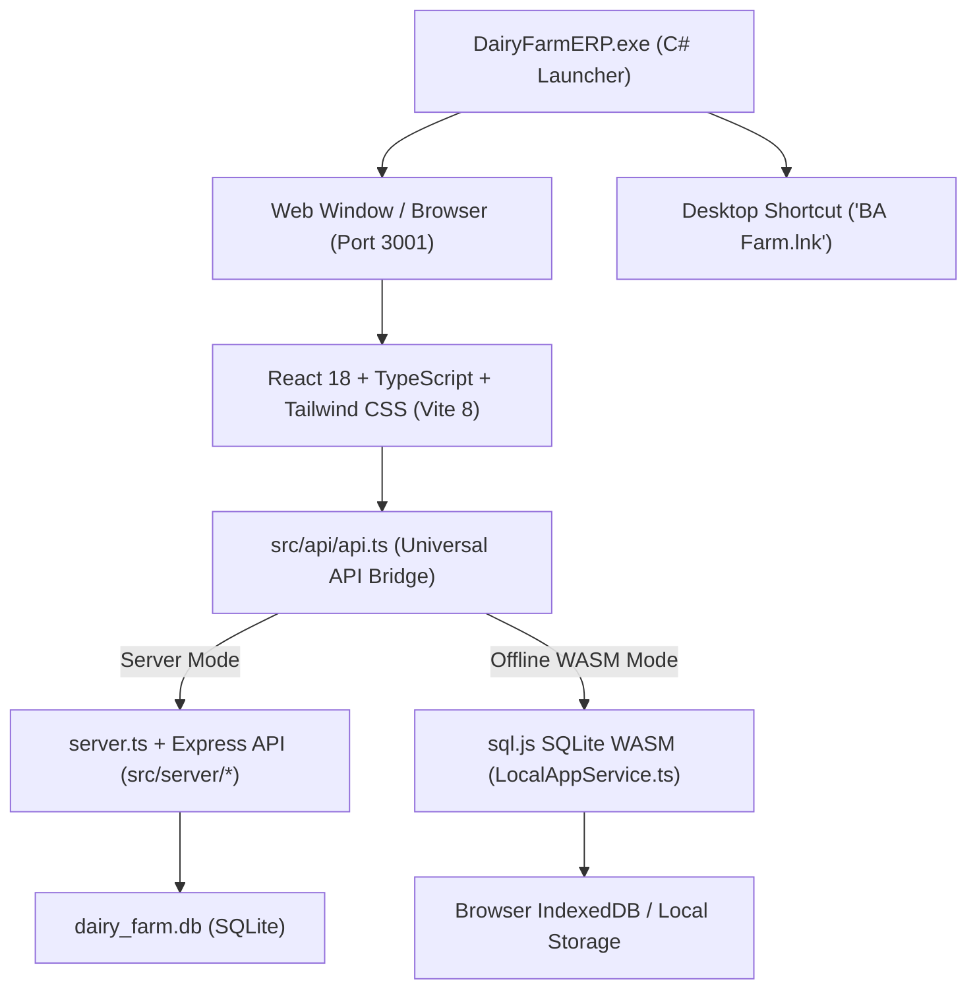

# 🧠 BA DAIRY FARM ERP — MASTER CODEBASE MEMORY & ARCHITECTURE MAP
> **File:** `CODEBASE_MEMORY.md`  
> **Last Updated:** 2026-11-15  
> **Repository:** `SAFIULLAH012/Dairy-Form-Management-System`  
> **Target Environment:** Windows 10/11 Desktop, Port 3001 / In-Memory WASM SQLite, React 18, Vite 8, TypeScript  

---

## 📌 1. AI Assistant & Developer Protocol (Permanent Rule)

This file is the **Single Source of Truth** for the entire project.

1. **Read-First Directive:**  
   When the user asks for ANY change, bug fix, or feature, **refer to this memory file first**. It maps every component, state variable, route, database column, and domain calculation so you do not need to scan the entire repository repeatedly.
2. **Synchronization Directive:**  
   Whenever ANY code is added, updated, refactored, or fixed, **update this memory file** in the same turn to keep it 100% in sync with the codebase.
3. **Local Persistence:**  
   This file stays permanently in the project root (`c:\Users\Seefoo Sial\Downloads\dairyform\CODEBASE_MEMORY.md`) and is tracked in Git.

---

## 🏗️ 2. Architectural Overview



- **Dual-Mode Backend Architecture:**
  - **Native Desktop / Express Server Mode:** `server.ts` launches an Express server on `http://127.0.0.1:3001` interacting with `dairy_farm.db`.
  - **Zero-Backend WASM Mode:** If running purely static/offline in a browser, `src/infrastructure/platform/web/WebAdapters.ts` and `src/domain/services/LocalAppService.ts` execute real SQLite queries in-memory using `sql.js` (WebAssembly) and persist snapshots to IndexedDB.
- **Port:** `3001` (managed automatically; launcher auto-kills stale zombie Node processes on this port before boot).
- **Embedded Desktop Launcher:** Compiled from `scripts/launcher/DairyFarmERP.cs` using `csc.exe`. Self-heals the desktop shortcut `BA Farm.lnk` with embedded `ba-farm.ico`.
- **Single-File Setup Installer:** Configured via `scripts/installer/setup.iss` and built via `scripts/build-installer.ps1`, producing `installer_output/BA_Farm_Setup.exe` (68.9 MB with embedded portable `node.exe`).

---

## 🗂️ 3. Master File Inventory & Directory Map

### 🖥️ Native Launcher & Packaging Scripts
| Path | Role & Summary | Key Functions / Exports |
| :--- | :--- | :--- |
| [`scripts/launcher/DairyFarmERP.cs`](file:///c:/Users/Seefoo%20Sial/Downloads/dairyform/scripts/launcher/DairyFarmERP.cs) | C# native Windows process supervisor and tray icon host. | `Main()`, `EnsureDesktopShortcut()`, `StartBackendServer()`, `FindNodeExecutable()`, `LaunchAppWindow()`, `FreePortIfOccupied()` |
| [`scripts/create-shortcut.ps1`](file:///c:/Users/Seefoo%20Sial/Downloads/dairyform/scripts/create-shortcut.ps1) | PowerShell script to generate/refresh Desktop shortcut with custom cow icon. | Creates `C:\Users\<User>\Desktop\BA Farm.lnk` pointing to `DairyFarmERP.exe` and `ba-farm.ico` |
| [`scripts/build-installer.ps1`](file:///c:/Users/Seefoo%20Sial/Downloads/dairyform/scripts/build-installer.ps1) | Orchestrates frontend Vite build, C# compile, portable node copy, and Inno Setup compilation. | Generates `installer_output/BA_Farm_Setup.exe` |
| [`scripts/installer/setup.iss`](file:///c:/Users/Seefoo%20Sial/Downloads/dairyform/scripts/installer/setup.iss) | Inno Setup 6 compilation script with maximum LZMA2 ultra solid compression. | Bundles app, assets, `node_modules`, and `runtime/node.exe` |
| [`scripts/build-distribution.ps1`](file:///c:/Users/Seefoo%20Sial/Downloads/dairyform/scripts/build-distribution.ps1) | Creates uncompressed portable folder `release/BA_Farm_ERP` with `HOW_TO_RUN.txt`. | Manual distribution generator |

---

### 🌐 Frontend Core & Layout (`src/`)
| Path | Role & Summary | Key Functions / Props |
| :--- | :--- | :--- |
| [`src/main.tsx`](file:///c:/Users/Seefoo%20Sial/Downloads/dairyform/src/main.tsx) | Application bootstrap entry point rendering `<App />`. | Mounts root React DOM |
| [`src/App.tsx`](file:///c:/Users/Seefoo%20Sial/Downloads/dairyform/src/App.tsx) | Main UI shell, sidebar, mobile navigation, module router, and Quick-Add state coordinator. | `currentTab`, `quickActionNonce`, `handleQuickAddNavigate()`, passes `autoOpenNonce` |
| [`src/index.css`](file:///c:/Users/Seefoo%20Sial/Downloads/dairyform/src/index.css) | Global styling, Tailwind directives, and the **Splendid Print Engine** (`@media print`). | `.printable-sheet`, `.signature-box`, exact print colors |
| [`src/api/api.ts`](file:///c:/Users/Seefoo%20Sial/Downloads/dairyform/src/api/api.ts) | Universal client API gateway; detects Express backend or switches to `LocalAppService`. | All `api.getAnimals()`, `api.createDelivery()`, `api.exportBackup()`, etc. |

---

### 🧩 UI Components (`src/components/`)
| Path | Role & Summary | Key Props & Features |
| :--- | :--- | :--- |
| [`src/components/Modal.tsx`](file:///c:/Users/Seefoo%20Sial/Downloads/dairyform/src/components/Modal.tsx) | Accessible dialog wrapper with backdrop, keyboard Esc listener, and clean footers. | `isOpen`, `onClose`, `title`, `maxWidth`, `footer` |
| [`src/components/Sidebar.tsx`](file:///c:/Users/Seefoo%20Sial/Downloads/dairyform/src/components/Sidebar.tsx) | Desktop side navigation with farm logo badge and pending notification indicators. | `currentTab`, `onSelectTab`, `pendingCount`, `NavItem` types |
| [`src/components/Header.tsx`](file:///c:/Users/Seefoo%20Sial/Downloads/dairyform/src/components/Header.tsx) | Top app header with active page title, mobile toggle, tasks shortcut, and Quick Add button. | `onQuickAdd`, `onOpenTasks`, `pendingCount` |
| [`src/components/QuickAddModal.tsx`](file:///c:/Users/Seefoo%20Sial/Downloads/dairyform/src/components/QuickAddModal.tsx) | 13-action quick-launch matrix covering all major farm transactions. | `onNavigate(tab: NavItem)` |
| [`src/components/AnimalProfileModal.tsx`](file:///c:/Users/Seefoo%20Sial/Downloads/dairyform/src/components/AnimalProfileModal.tsx) | Detailed animal passport popup modal with 14-day production graph and print passport button. | `animalId`, `isOpen`, `onClose`, `.printable-sheet` |
| [`src/components/AnimalSearchInput.tsx`](file:///c:/Users/Seefoo%20Sial/Downloads/dairyform/src/components/AnimalSearchInput.tsx) | Autocomplete animal selector with live dropdown filtering, clear button, and outside click. | `value`, `onChange`, `animals`, `sexFilter` |
| [`src/components/IndividualMilkModal.tsx`](file:///c:/Users/Seefoo%20Sial/Downloads/dairyform/src/components/IndividualMilkModal.tsx) | Per-cow shift milking logger with batch saving and status tracking. | Cow-level yield data entries |
| [`src/components/ErrorBoundary.tsx`](file:///c:/Users/Seefoo%20Sial/Downloads/dairyform/src/components/ErrorBoundary.tsx) | React lifecycle error boundary preventing UI crashes. | Fallback UI with reload option |

---

### 📄 Application Pages (`src/pages/`)
| Page | File | Auto-Open Nonce Target | Print Engine Features |
| :--- | :--- | :--- | :--- |
| **Dashboard** | [`DashboardPage.tsx`](file:///c:/Users/Seefoo%20Sial/Downloads/dairyform/src/pages/DashboardPage.tsx) | N/A (Overview) | Live herd KPI cards, daily milk summary, financial pulse |
| **Female Cattle** | [`AnimalsPage.tsx`](file:///c:/Users/Seefoo%20Sial/Downloads/dairyform/src/pages/AnimalsPage.tsx) | `handleOpenAdd()` | Herd directory, status switcher, sale/deceased modals, timeline |
| **Male Animals** | [`MaleAnimalsPage.tsx`](file:///c:/Users/Seefoo%20Sial/Downloads/dairyform/src/pages/MaleAnimalsPage.tsx) | `handleOpenAdd()` | Breeding bull and male calf registry with growth stages |
| **Visual Profiles** | [`CowProfilesPage.tsx`](file:///c:/Users/Seefoo%20Sial/Downloads/dairyform/src/pages/CowProfilesPage.tsx) | N/A (Visual Grid) | **Print Passport:** Certified Bovine Pedigree & Medical Passport |
| **Milk Production** | [`MilkPage.tsx`](file:///c:/Users/Seefoo%20Sial/Downloads/dairyform/src/pages/MilkPage.tsx) | `setShowTotalModal(true)` | Bulk shift milk records, weighted Fat/SNF %, lock/unlock audit |
| **Milk Sales** | [`SalesPage.tsx`](file:///c:/Users/Seefoo%20Sial/Downloads/dairyform/src/pages/SalesPage.tsx) | `setShowInvoiceModal(true)` | **Print Delivery Slip:** Quality lab tests, terms, dual seals. Customer autocomplete + Erase All Data |
| **Customer Ledgers** | [`CustomersPage.tsx`](file:///c:/Users/Seefoo%20Sial/Downloads/dairyform/src/pages/CustomersPage.tsx) | `handleOpenAdd()` | **Print Statement:** Bank-grade account ledger with payment history |
| **Feed Management**| [`FeedPage.tsx`](file:///c:/Users/Seefoo%20Sial/Downloads/dairyform/src/pages/FeedPage.tsx) | `setShowAddModal(true)` | Maund/KG conversion ($1\text{ M} = 40\text{ KG}$), active cow count sync |
| **Inventory** | [`InventoryPage.tsx`](file:///c:/Users/Seefoo%20Sial/Downloads/dairyform/src/pages/InventoryPage.tsx) | `setShowTransactionModal(true)`| Multi-category stock movements (`STOCK_IN`/`OUT`/`WASTAGE`), depletion alerts |
| **Veterinary Health**| [`HealthPage.tsx`](file:///c:/Users/Seefoo%20Sial/Downloads/dairyform/src/pages/HealthPage.tsx) | `handleOpenAdd()` | Disease records, medications, dosages, clinical follow-ups |
| **Vaccinations** | [`VaccinationPage.tsx`](file:///c:/Users/Seefoo%20Sial/Downloads/dairyform/src/pages/VaccinationPage.tsx) | `setShowAddModal(true)` | Immunization schedule (FMD, BQ, HS), auto next due dates |
| **Breeding & Calves**| [`BreedingPage.tsx`](file:///c:/Users/Seefoo%20Sial/Downloads/dairyform/src/pages/BreedingPage.tsx) | `setShowEventModal(true)` | 283-day calving timer, 60-day dry-off alert, 21-day heat cycles |
| **Tasks & Alerts** | [`RemindersPage.tsx`](file:///c:/Users/Seefoo%20Sial/Downloads/dairyform/src/pages/RemindersPage.tsx) | `setShowAddModal(true)` | Cross-module task tracking with status badges and quick routing |
| **Staff & Payroll** | [`WorkersPage.tsx`](file:///c:/Users/Seefoo%20Sial/Downloads/dairyform/src/pages/WorkersPage.tsx) | `setShowAddWorkerModal(true)` | Employee registry, salary advances, deductions, net salary ledger |
| **Expenses** | [`ExpensesPage.tsx`](file:///c:/Users/Seefoo%20Sial/Downloads/dairyform/src/pages/ExpensesPage.tsx) | `setShowAddModal(true)` | Categorized outlays with date range filters |
| **Financial Reports**| [`ReportsPage.tsx`](file:///c:/Users/Seefoo%20Sial/Downloads/dairyform/src/pages/ReportsPage.tsx) | N/A (Report View) | **Print Statement:** Executive Boardroom Financial Statement with produced vs. sold reconciliation & unit economics |
| **System Settings** | [`SettingsPage.tsx`](file:///c:/Users/Seefoo%20Sial/Downloads/dairyform/src/pages/SettingsPage.tsx) | N/A (Config) | Farm identity setup, universal JSON database backup & restore |

---

### 📐 Domain Logic & Business Rules (`src/domain/`)
| File | Role | Key Functions / Business Rules |
| :--- | :--- | :--- |
| [`calculations.ts`](file:///c:/Users/Seefoo%20Sial/Downloads/dairyform/src/domain/calculations.ts) | Mathematical formulas & domain logic | `calculateAge(dob)` $\to$ returns `{ years, months, display }`<br>`maundToKg(maund)` $= \text{maund} \times 40$<br>`kgToMaund(kg)` $= \text{kg} / 40$<br>`calculateBreedingPredictions(aiDate)` $\to$ Calving $+283\text{d}$, Dry-off $-60\text{d}$ from calving, Next Heat $+21\text{d}$<br>`calculateWeightedMetrics(entries)` $\to$ Weighted Fat % & SNF %<br>`calculateMilkReconciliation(produced, sold)` $\to$ discrepancy & percentage sold<br>`calculateInventoryDaysRemaining(stock, dailyRate)` |
| [`types.ts`](file:///c:/Users/Seefoo%20Sial/Downloads/dairyform/src/domain/types.ts) | TypeScript interfaces & domain entities | `Animal`, `MilkTotal`, `MilkEntry`, `Delivery`, `Customer`, `FeedTransaction`, `HealthCase`, `Vaccination`, `BreedingRecord`, `Expense`, `Worker`, `Task` |
| [`repositories.ts`](file:///c:/Users/Seefoo%20Sial/Downloads/dairyform/src/domain/repositories.ts) | Repository interfaces | Abstraction for database contracts |
| `services/*` | Domain business services | Decoupled business controllers (`AnimalService`, `MilkCalculationService`, `SalesInvoiceService`, `FeedInventoryService`, `HealthBreedingService`, `ReportService`, `AuditBackupService`) |

---

### 💾 Database & Storage Layer (`src/infrastructure/database/`)
- **Engine:** SQLite (WASM via `sql.js` in browser / native in Node.js via `better-sqlite3` or SQLite memory).
- **Migrations (`migrations.ts`):**
  1. `001_initial_schema`: Core tables (`animals`, `milk_totals`, `milk_entries`, `customers`, `deliveries`, `feed_transactions`, `inventory_items`, `inventory_transactions`, `health_cases`, `vaccinations`, `breeding_records`, `calf_growth`, `expenses`, `workers`, `worker_transactions`, `tasks`, `settings`).
  2. `002_performance_indexes`: Added indexing on `animals(status, sex)`, `milk_totals(date, shift)`, `deliveries(date, customer_id)`, `expenses(date, category)`.
  3. `003_milk_corrections_audit`: Added audit trail table for unlock reason logging.
  4. `004_feed_cow_count`: Cow count tracking per feeding event.

---

### 🖥️ Express Server Routes (`src/server/routes/`)
- `animal.routes.ts`: `/api/animals`, `/api/animals/:id`, status transitions.
- `milk.routes.ts`: `/api/milk/totals`, `/api/milk/entries`, `/api/milk/unlock`.
- `sales.routes.ts`: `/api/deliveries`, `/api/customers`, payment recording.
- `feed.routes.ts`: `/api/feed/transactions`, maund calculations.
- `inventory.routes.ts`: `/api/inventory/items`, `/api/inventory/movements`.
- `healthCare.routes.ts` & `breeding.routes.ts`: Medical cases, vaccinations, AI services.
- `worker.routes.ts` & `finance.routes.ts`: Salary ledger, advances, expenses.
- `report.routes.ts`: Financial statements, reconciliation, herd statistics.
- `system.routes.ts`: Database backup export (`/api/backup/export`) and restore (`/api/backup/restore`).

---

## 🖨️ 4. The Splendid Print Engine Specification

All documents share the **BA Dairy Farm Boardroom Print Standard** implemented in `src/index.css`:
```css
@media print {
  body { background: #ffffff !important; color: #111827 !important; }
  aside, header, nav, button, .no-print { display: none !important; }
  .printable-sheet { border: 1px solid #d1d5db !important; padding: 24px !important; page-break-inside: avoid; }
  table { width: 100% !important; border-collapse: collapse !important; }
  th, td { border-color: #e5e7eb !important; }
  * { -webkit-print-color-adjust: exact !important; print-color-adjust: exact !important; }
  .signature-box { border-top: 1px solid #9ca3af !important; margin-top: 40px !important; }
}
```

### Documents & Locations:
1. **Milk Delivery Slip & Invoice** ([`SalesPage.tsx#L680-L800`](file:///c:/Users/Seefoo%20Sial/Downloads/dairyform/src/pages/SalesPage.tsx)):
   - Farm brand header, consignment card, quality testing table (Volume, Fat %, SNF %, Rate/L), payment balance card (Gross, Paid, Balance Due), purity warranty, and dual dispatcher/receiver signature seals.
2. **Customer Account Statement** ([`CustomersPage.tsx#L355-L480`](file:///c:/Users/Seefoo%20Sial/Downloads/dairyform/src/pages/CustomersPage.tsx)):
   - Bank-grade statement with client contact dossier, Total Billed, Total Settled, Outstanding Due, itemized delivery ledger, and official accountant validation stamp.
3. **Certified Bovine Passport & Pedigree** ([`CowProfilesPage.tsx#L205-L390`](file:///c:/Users/Seefoo%20Sial/Downloads/dairyform/src/pages/CowProfilesPage.tsx)):
   - Animal photo, ear tags, breed, pedigree (Sire/Dam), 14-day yield sparkline, lifetime medical cases, and signatures for Herd Registrar and Attending Veterinarian.
4. **Boardroom Financial & Operational Statement** ([`ReportsPage.tsx#L125-L335`](file:///c:/Users/Seefoo%20Sial/Downloads/dairyform/src/pages/ReportsPage.tsx)):
   - Executive header, produced vs. sold milk reconciliation, unit economics matrix (Cost/L, Margin/L), and CEO/CFO verification seals.

---

## ⚡ 5. Recent Feature Additions & Enhancements

### 1. Delivery Invoice Autocomplete & Erase All Data Button
- **File:** [`src/pages/SalesPage.tsx`](file:///c:/Users/Seefoo%20Sial/Downloads/dairyform/src/pages/SalesPage.tsx)
- **Features:**
  - Replaced rigid `<select>` dropdown with a hybrid autocomplete input.
  - Suggests matching customers as the user types (name, company, phone, rate).
  - Allows typing custom customer/company names; auto-creates them on save.
  - Added **"Erase All Data"** button (`RotateCcw`) in modal footer to clear all fields to blank.

### 2. Quick Add Modal Auto-Opening
- **File:** [`src/App.tsx`](file:///c:/Users/Seefoo%20Sial/Downloads/dairyform/src/App.tsx) & [`src/components/QuickAddModal.tsx`](file:///c:/Users/Seefoo%20Sial/Downloads/dairyform/src/components/QuickAddModal.tsx)
- **Features:**
  - Clicking any of the 13 quick actions switches to the target tab and automatically opens its creation modal using `autoOpenNonce`.

### 3. Transparent Circular Cow Icon & Desktop Shortcut
- **Files:** [`ba-farm.ico`](file:///c:/Users/Seefoo%20Sial/Downloads/dairyform/ba-farm.ico), [`scripts/create-shortcut.ps1`](file:///c:/Users/Seefoo%20Sial/Downloads/dairyform/scripts/create-shortcut.ps1), [`scripts/launcher/DairyFarmERP.cs`](file:///c:/Users/Seefoo%20Sial/Downloads/dairyform/scripts/launcher/DairyFarmERP.cs)
- **Features:**
  - Embedded multi-resolution icon (16px to 256px) with 100% alpha transparency outside circle.
  - `DairyFarmERP.exe` self-heals `BA Farm.lnk` on user's desktop upon launch.

### 4. Single-File Setup Installer (`BA_Farm_Setup.exe`)
- **Files:** [`scripts/installer/setup.iss`](file:///c:/Users/Seefoo%20Sial/Downloads/dairyform/scripts/installer/setup.iss), [`scripts/build-installer.ps1`](file:///c:/Users/Seefoo%20Sial/Downloads/dairyform/scripts/build-installer.ps1)
- **Output:** `installer_output/BA_Farm_Setup.exe` (68.9 MB).
- **Features:** Bundles application, SQLite engine, assets, and portable `node.exe` runtime so recipient needs zero prerequisites.

---

## 🧪 6. Testing & Build Verification Suite

1. **TypeScript Typecheck:**
   ```bash
   npx tsc --noEmit
   # Must return 0 errors
   ```
2. **Domain Business Calculation Tests (24 Tests):**
   ```bash
   npm test
   # Runs tests/domain.test.ts
   ```
3. **Database & Memory Performance Benchmarks:**
   ```bash
   npm run test:perf
   # Runs tests/performance.test.ts (1,000 inserts in ~420ms)
   ```
4. **Vite Production Bundle:**
   ```bash
   npm run build
   # Generates optimized dist/
   ```
5. **Launcher Executable Compilation:**
   ```bash
   npm run build:exe
   # Compiles DairyFarmERP.exe via csc.exe with ba-farm.ico
   ```
6. **Single-File Setup Installer Build:**
   ```bash
   npm run build:installer
   # Compiles installer_output/BA_Farm_Setup.exe
   ```
