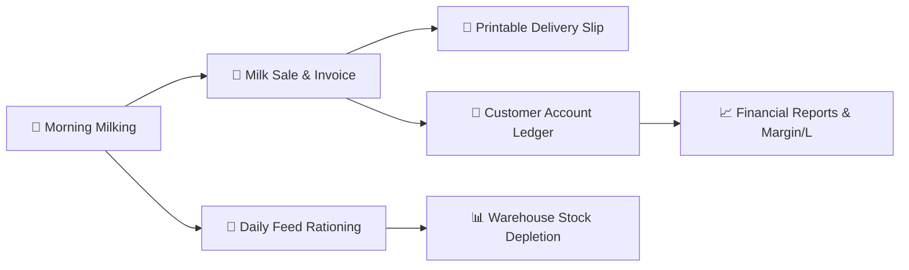

# 📖 BA Dairy Farm ERP — Complete User Guide & Distribution Manual

---

## 🌟 1. System Overview

**BA Dairy Farm ERP** is a modern, high-performance, full-stack management and financial accounting software engineered specifically for commercial dairy farms and livestock enterprises. It operates 100% offline with zero cloud dependency, powered by a native Windows desktop launcher, an embedded SQLite database engine (with sub-millisecond WASM query execution), and a responsive React 18 interface.

---

## 🚀 2. How to Run the Software on Your PC

Running the software on your primary machine is straightforward:

1. Navigate to the project folder: `c:\Users\Seefoo Sial\Downloads\dairyform`
2. Double-click **`DairyFarmERP.exe`**.
3. The launcher will automatically:
   - Check port availability and launch the local background database engine.
   - Launch your default web browser or dedicated app window at `http://127.0.0.1:3001`.
   - **Create or update a Desktop shortcut named "BA Farm"** with the high-resolution circular cow icon (`ba-farm.ico`).
4. On subsequent launches, you can simply double-click the **BA Farm** shortcut on your Windows desktop.

---

## 📦 3. How to Compile the Native Windows Executable (`.exe`)

The Windows executable is compiled directly from C# source code using Microsoft's native .NET compiler (`csc.exe`). No heavy build tools or Visual Studio installations are required.

To recompile the executable:
```bash
npm run build:exe
```
This command compiles [`scripts/launcher/DairyFarmERP.cs`](file:///c:/Users/Seefoo%20Sial/Downloads/dairyform/scripts/launcher/DairyFarmERP.cs) and embeds [`ba-farm.ico`](file:///c:/Users/Seefoo%20Sial/Downloads/dairyform/ba-farm.ico) directly into the binary, producing a fresh **`DairyFarmERP.exe`**.

---

## 🌐 4. How to Distribute the Software to Another Person

> [!IMPORTANT]
> **Do not send the solitary `DairyFarmERP.exe` file alone.**  
> `DairyFarmERP.exe` is the native desktop process supervisor. It orchestrates the local SQLite database, backend services, and web assets located within the application folder. To run on another PC, you must send the entire application folder (packaged as a ZIP archive).

When the recipient receives the package and double-clicks `DairyFarmERP.exe`, their machine needs the following:

### Option A: Standard Setup (Recommended & Standard)
1. **Operating System:** Windows 10 or Windows 11 (64-bit).
2. **Node.js Runtime (LTS):** The recipient needs Node.js installed on their computer (download free from [nodejs.org](https://nodejs.org)).
3. **Automated Assistance:** If the recipient does not have Node.js installed, `DairyFarmERP.exe` will detect this on first launch and display a helpful prompt:
   > *"Node.js runtime was not detected on this computer. Would you like to open https://nodejs.org to download it now?"*  
   Clicking **Yes** opens the Node.js download page. Once installed, the application runs immediately.

### Option B: 100% Zero-Dependency Standalone Mode (No Node.js Installation Required)
If you want to provide a package to a client who cannot or does not want to install Node.js:
1. Locate `node.exe` on your computer (typically at `C:\Program Files\nodejs\node.exe`).
2. Copy `node.exe` directly into the root of the application folder (or inside a subfolder named `runtime/`).
3. Zip and send the folder.
4. The recipient does not need to install anything. Double-clicking `DairyFarmERP.exe` will detect the local `node.exe` and start the system immediately.

---

## ⚡ 5. One-Click Automated Distribution Packager

An automated distribution script is included in the project:
```powershell
powershell -ExecutionPolicy Bypass -File scripts/build-distribution.ps1
```
This script executes the following automated steps:
1. Compiles and minifies the client-side production bundle (`npm run build`).
2. Recompiles `DairyFarmERP.exe` with the latest icon (`npm run build:exe`).
3. Creates a clean distribution directory at `release/BA_Farm_ERP/`.
4. Copies all necessary binaries, static assets, database migrations, and icons.
5. Generates end-user instructions (`HOW_TO_RUN.txt`) and a backup launcher (`Start-BA-Farm.bat`).
6. You can zip the resulting `release/BA_Farm_ERP/` folder and transfer it via USB drive, network share, or cloud link to any client.

---

## 📋 6. Detailed Module Guide & Daily Farm Workflow



---

### Module 1: Herd Management (`AnimalsPage.tsx` & `MaleAnimalsPage.tsx`)
- **Registering Cattle:** Click the yellow **⚡ Quick Add** button in the top header and select **🐄 Female Animal** or **🐂 Male Animal**.
- **Key Demographics:**
  - **Tag Number / Ear Tag 1 & Tag 2:** Official animal identification.
  - **Breed:** Select from Sahiwal, Cholistani, Red Sindhi, Holstein Friesian, Jersey, Cross, or enter a custom breed.
  - **Origin:** Specify *Farm Born* or *Purchased* (with purchase date, acquisition cost, and supplier name).
  - **Lactation & Stage:** Set stage (Calf, Heifer, Adult) and status (Milking, Dry, Pregnant).
- **Life Event Actions:**
  - **Mark as Sold:** Record buyer name, sale date, and final sale price (automatically reflected in financial revenue).
  - **Mark as Deceased:** Record death date and clinical cause of death (removes animal from active herd metrics).

---

### Module 2: Visual Cow Profiles & Printable Bovine Passport (`CowProfilesPage.tsx`)
- **Visual Card Grid:** Displays photo avatars or initials, breed tags, current reproductive status, and 14-day production trend sparklines.
- **Search & Filters:** Real-time search across ID, Tag number, Cow Number, and Breed; filter by sex (Female / Male) or status (Active, Sold, Deceased).
- **Bovine Passport Printing:**
  - Click any cow card to open the slide-out dossier.
  - Click **Print Passport** in the header.
  - Generates an official, certified **Bovine Pedigree, Lactation & Medical Passport** containing lifetime health cases, vaccination dates, milk performance, and signature boxes for the *Attending Veterinarian* and *Herd Registrar*.

---

### Module 3: Daily Milk Production (`MilkPage.tsx`)
- **Logging Shift Totals:** Click **⚡ Quick Add** $\to$ **🥛 Daily Milk Record**.
- **Shift Selection:** Choose Morning or Evening shift.
- **Production Metrics:** Enter Total Litres produced across the herd.
- **Quality Parameters:** Enter laboratory Fat % (e.g. 4.10%) and Solids-Not-Fat SNF % (e.g. 8.55%).
- **Shift Balancing & Security:** Individual cow yields can be logged and matched against the bulk vat total. Historical entries can be locked against accidental tampering, requiring an authorized unlock reason to edit.

---

### Module 4: Milk Sales, Invoices & Delivery Slips (`SalesPage.tsx`)
- **Creating a Delivery Voucher:** Click **+ Record Milk Sale**.
- **Auto-Fill:** The system automatically selects active commercial buyers and populates available morning milk volume.
- **Pricing & Payment Terms:** Applies agreed rate per litre (e.g. Rs. 210/L) and credit terms (e.g. 7-day payment window). Enter any cash advance received upon dispatch.
- **Printable Delivery Slip:**
  - Click the printer icon 🖨️ next to any invoice.
  - An official delivery voucher is generated with farm branding, consignee details, fat/SNF inspection readings, financial breakdown (Billed, Paid, Remaining Due), quality warranty statement, and dual signature lines for the *Farm Dispatcher* and *Customer Receiver*.

---

### Module 5: Customer Accounts & Ledger Statements (`CustomersPage.tsx`)
- **Customer Directory:** Track dairy buyers, retail shops, processing plants, contract rates, and phone numbers.
- **Viewing Client Ledgers:** Click **Ledger** on any customer row to view:
  - Total Billed Amount.
  - Total Settled Payments.
  - Outstanding Balance Due.
  - Chronological transaction history of all deliveries.
- **Printable Customer Account Statement:**
  - Click **Print Statement** at the bottom of the ledger.
  - Renders a formal bank-grade financial statement showing all unbilled and partially settled deliveries with authorization and buyer acceptance signatures.

---

### Module 6: Daily Feed Rationing (`FeedPage.tsx`)
- **Group Feeding:** Select herd group (High Yielders, Milking, Dry, Calves). The system automatically retrieves the number of active animals in that group.
- **Maund to KG Conversion:** Input feed quantity in Maund or KG ($1\text{ Maund} = 40\text{ KG}$).
- **Automatic Cost Calculation:** Computes total outlay based on inventory unit purchase rates.
- **Warehouse Link:** Automatically checks inventory reserves and alerts if stock is below required consumption levels.

---

### Module 7: Inventory & Warehouse Logistics (`InventoryPage.tsx`)
- **Categories:** Track Feeds, Veterinary Medicines, Vaccines, and General Farm Supplies.
- **Stock Movement Types:** Record `STOCK_IN` (new shipments), `STOCK_OUT` (warehouse consumption), `ADJUSTMENT` (physical count corrections), and `WASTAGE` (spoilage/damage).
- **Depletion Alerts:** Automated warning badges trigger when stock levels fall below minimum safety thresholds.

---

### Module 8: Health, Veterinary Cases & Vaccinations (`HealthPage.tsx` & `VaccinationPage.tsx`)
- **Veterinary Cases:** Record clinical symptoms, tentative diagnosis, prescribed medications, dosages, clinical fees, and follow-up consultation dates.
- **Vaccination Calendar:** Track herd coverage against Foot and Mouth Disease (FMD), Black Quarter (BQ), Hemorrhagic Septicemia (HS), and routine Deworming. The system automatically computes the next immunization due date.

---

### Module 9: Breeding, Calving & Calf Growth (`BreedingPage.tsx`)
- **Artificial Insemination (AI):** Log insemination date, bull ID/breed, and inseminator identity.
- **Biological Timers:**
  - $\text{Expected Calving Date} = \text{AI Date} + 283\text{ days}$
  - $\text{Recommended Dry-Off Date} = \text{Calving Date} - 60\text{ days}$
  - $\text{Next Heat Cycle} = \text{Heat Date} + 21\text{ days}$
- **Calving Workflow:** Record newborn calf sex, birth weight, and dam tag. With a single click, convert the calf into a permanent herd record.

---

### Module 10: Workers & Payroll Ledger (`WorkersPage.tsx`)
- **Staff Directory:** Manage milkers, farm hands, and supervisors with joining dates and fixed monthly compensation.
- **Advance & Salary Ledger:** Record mid-month salary advances, deductions, or bonuses. Computes net salary payable at month-end.

---

### Module 11: Operational Expenses (`ExpensesPage.tsx`)
- **Expense Categorization:** Log Electricity, Fuel, Maintenance, Labour, Veterinary, and Miscellaneous outlays.
- **Date Range Filters:** Filter expenses by month or custom calendar ranges to analyze cost distribution.

---

### Module 12: Executive Financial Statements & Reconciliation (`ReportsPage.tsx`)
- **Milk Production vs. Sales Reconciliation:** Audits total milk produced against total milk sold to calculate calf milk and farm-retained discrepancy, preventing unrecorded loss.
- **Unit Economics Matrix:**
  - $\text{Feed Cost per Litre} = \frac{\text{Total Feed Outlay}}{\text{Total Litres Produced}}$
  - $\text{Total Operational Cost per Litre} = \frac{\text{Total Costs}}{\text{Total Litres Produced}}$
  - $\text{Average Sale Price per Litre} = \frac{\text{Milk Sales Revenue}}{\text{Total Litres Sold}}$
  - $\text{Net Margin per Litre} = \text{Average Sale Price} - \text{Total Cost per Litre}$
- **Printable Executive Statement:** Click **Print Report** to generate a boardroom-quality audited financial statement with signature spaces for the *Chief Accountant* and *Farm Owner*.

---

### Module 13: Database Backup & Disaster Recovery (`SettingsPage.tsx`)
- **One-Click Universal Backup:** Go to **System Settings** and click **Backup Database (JSON)**.
- **Safe Storage:** Downloads a complete, uncorrupted snapshot of your entire farm database (animals, milk totals, sales, feed, medical records, expenses).
- **Restoration:** If you ever migrate to a new computer, open **System Settings**, click **Restore Database**, and select your JSON backup file. All farm records will be restored instantly.

---

## 🖨️ 7. Print Engine Quality Guidelines

When printing invoices, statements, or cow passports via physical printers or "Save as PDF":
1. In the browser print dialog, ensure **Background graphics** is checked so badges, headers, and colored status indicators render accurately.
2. Select **Paper Size: A4** and **Margins: Default or None**.
3. All printable sheets utilize the `.printable-sheet` CSS specification, automatically suppressing navigation bars, buttons, and backgrounds to deliver clean output.

---

## ❓ 8. Frequently Asked Questions (FAQ)

**Q: Does this software require an active internet connection?**  
**A:** No. It is an offline desktop management system. It runs entirely on your local machine without transmitting data externally.

**Q: Can multiple devices on the farm access the system at once?**  
**A:** Yes. If the host machine running `DairyFarmERP.exe` is connected to a local farm Wi-Fi router or LAN, other tablets, laptops, or mobile phones on the same network can access the system by opening `http://<HOST_IP_ADDRESS>:3001` in their browser.

**Q: Where is my data saved?**  
**A:** In standalone mode, data is safely maintained in the local SQLite database (`dairy_farm.db` / browser indexed storage). Regular weekly backups via **System Settings $\to$ Backup Database** are recommended.
